# Black-Scholes Pricer

[](https://github.com/Dhirajdas18/black-scholes-pricer/actions/workflows/ci.yml)
[](https://dhirajdas18.github.io/black-scholes-pricer/)

European option pricing with the Black-Scholes model, tested against what NSE options actually did: what
NIFTY options cost against what they paid, how the Greeks behave, implied volatility on real option
prices, and delta hedging on real NIFTY paths.

**Live calculator and dashboard: [dhirajdas18.github.io/black-scholes-pricer](https://dhirajdas18.github.io/black-scholes-pricer/)**.
The pricer runs in the browser as you type; the charts are rebuilt weekly by GitHub Actions.

## Features

- [x] Black-Scholes prices with a dividend yield, put-call parity, Monte Carlo check (antithetic paths)
- [x] In-browser pricer, tested against the Python implementation through Node
- [x] Greeks: delta, gamma, vega, theta, rho (analytic, tested against finite differences; live in the calculator)
- [x] Implied volatility on real NIFTY option prices (NSE bhavcopy, 2015–2026); smile and skew
- [x] Delta hedging on real NIFTY paths, at real implied volatilities
- [x] Black-76 for options on futures (also in the calculator: enter a futures price)
- [ ] Indian option costs (STT on premium and exercise) and what option strategies net
- [ ] Model limits: jump-diffusion vs Black-Scholes

## Findings

### 1. Priced at India VIX, a NIFTY put cost a third more than it paid out on average, until one month

<table><tr>
<td><a href="docs/img/pricing_insurance.png"><picture><source media="(prefers-reduced-motion: reduce)" srcset="docs/img/pricing_insurance.png">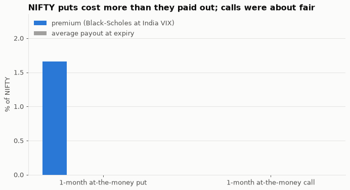</picture></a></td>
<td><a href="docs/img/pricing_seller.png"><picture><source media="(prefers-reduced-motion: reduce)" srcset="docs/img/pricing_seller.png"></picture></a></td>
</tr></table>

Each month, a one-month at-the-money NIFTY option is priced with Black-Scholes at that day's India VIX
(a 6.5% risk-free rate, no dividends) and held to expiry. Months don't overlap; every figure is the median
across the 21 possible monthly start days (162 months each), so no start date is cherry-picked.

- **Puts:** the premium averaged 1.66% of NIFTY and the payout 1.26%. A put seller kept about 0.40% of the
  index a month before costs, positive for every start day (0.30% to 0.48%). Puts finished in the money in
  40% of months.
- **One month erased years of that.** From 18 Feb 2020 the put paid out 27% of the index against a 1.4%
  premium, wiping out more than five years of the seller's gains in one month.
- **Calls were about fair:** 2.20% premium against 2.24% average payout. Black-Scholes uses one volatility
  for both, and India VIX ran above the volatility that followed
  ([returns-volatility study](https://github.com/Dhirajdas18/returns-volatility-dashboard)), but NIFTY's
  drift above the risk-free rate added to calls and took from puts.
- These are model prices at India VIX, not traded premiums; section 3 repeats the comparison with real NSE
  option prices, where out-of-the-money puts cost more than India VIX implies.

<a href="docs/img/pricing_mc.png"><picture><source media="(prefers-reduced-motion: reduce)" srcset="docs/img/pricing_mc.png"></picture></a>

- **The formula checks out:** a one-million-path Monte Carlo (antithetic pairs) priced a test put at
  7.0986 ± 0.0054 against the formula's 7.1061, within 1.4 standard errors. The tests also pin Hull's
  textbook example (call 4.76, put 0.81) and put-call parity.

### 2. NIFTY beat its daily break-even move less often than Black-Scholes assumes, except in jumps

<table><tr>
<td><a href="docs/img/greeks_curves.png"><picture><source media="(prefers-reduced-motion: reduce)" srcset="docs/img/greeks_curves.png">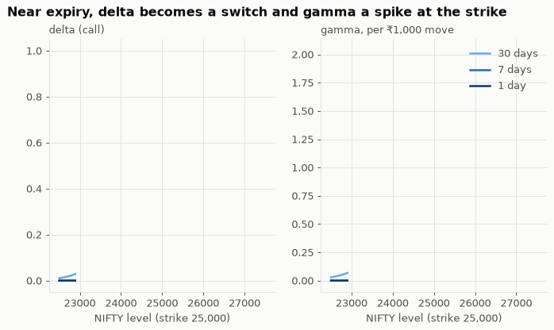</picture></a></td>
<td><a href="docs/img/greeks_theta.png"><picture><source media="(prefers-reduced-motion: reduce)" srcset="docs/img/greeks_theta.png"></picture></a></td>
</tr></table>

The Greeks measure how an option's price reacts to each input: **delta** to the price, **gamma** to how
fast delta changes, **vega** to volatility, **theta** to time, **rho** to interest rates. All five are
tested against finite differences and shown live in the [calculator](https://dhirajdas18.github.io/black-scholes-pricer/).

- **Near expiry, an at-the-money option turns into a switch.** With a day left, delta jumps from 0 to 1
  across a few hundred points of NIFTY and gamma is about five times its 30-day level (left).
- **Time decay speeds up:** an at-the-money call loses half its value in the first 21.5 of its 30 days and
  the other half in the last 8.5 (right).

<a href="docs/img/greeks_breakeven.png"><picture><source media="(prefers-reduced-motion: reduce)" srcset="docs/img/greeks_breakeven.png">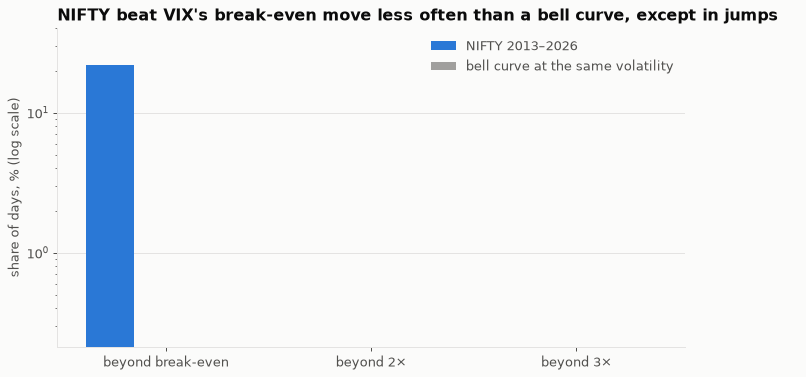</picture></a>

- **The daily race between gamma and theta:** an at-the-money option holder gains from big moves and pays
  time decay every day, and the two cancel when NIFTY moves India VIX ÷ √252 in a day. Over 3,413 days
  NIFTY beat that break-even move on 21.9% of days, where a bell curve at the same volatility gives 31.7%,
  so the holder lost the day 78% of the time.
- **But the biggest days were bigger than a bell curve allows:** moves beyond 3× the break-even came on
  0.35% of days against 0.27%. The top 1% of days earned back about half of the holder's daily losses;
  the holder still finished behind. This is the volatility risk premium seen one day at a time.
- **Delta and gamma predict a day's option price change well, until a jump:** for a 30-day at-the-money
  call, delta + gamma + theta missed the real change by a median 0.03% of the option's price, 0.37% on days
  NIFTY moved more than 3%, and 9.2% on 20 Sep 2019 (the corporate-tax-cut day, NIFTY +5.2%).

### 3. Real NIFTY options charge more for crash protection than Black-Scholes allows, in every month since 2015

<a href="docs/img/iv_smile.png"><picture><source media="(prefers-reduced-motion: reduce)" srcset="docs/img/iv_smile.png">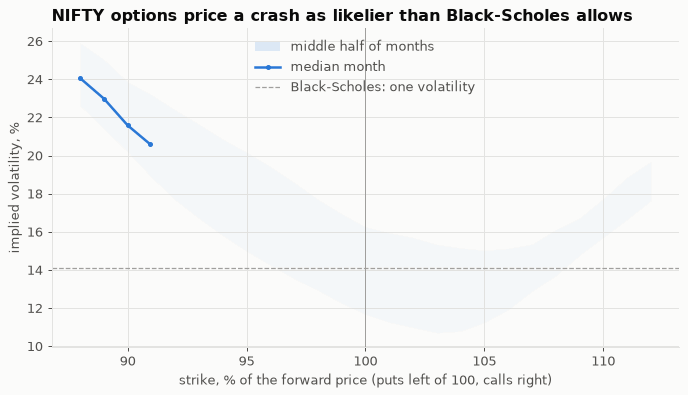</picture></a>

Black-Scholes assumes one volatility for every strike. Backing implied volatility out of real NIFTY
option closing prices (NSE's daily F&O bhavcopy, the first trading day of each month, the monthly expiry
about four weeks out; 143 months, 2015–2026) shows a lopsided smile instead.

- **The skew:** in the median month, a put 5% below the forward traded at 17.2% volatility, the
  at-the-money option at 14.1% and a call 5% above at 12.7%. Puts 10% below: 21.6%.
- **It never flipped.** The 95% put sat above the 105% call in all 143 months, by a median 4.4 points
  (2.7 to 6.4 in nine months out of ten). The widest gap was 10.1 points, on 1 Apr 2020, after the crash.
- The forward price comes from put-call parity at the at-the-money strike, so no dividend guess is
  needed; it matched NIFTY futures to within 0.08% every month.

<table><tr>
<td><a href="docs/img/iv_premium.png"><picture><source media="(prefers-reduced-motion: reduce)" srcset="docs/img/iv_premium.png">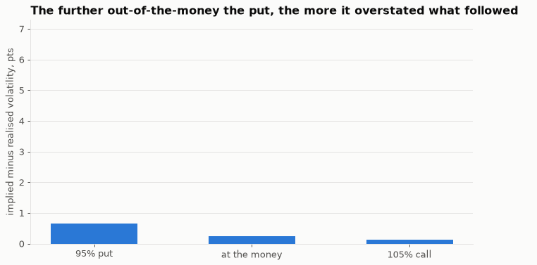</picture></a></td>
<td><a href="docs/img/iv_skew.png"><picture><source media="(prefers-reduced-motion: reduce)" srcset="docs/img/iv_skew.png">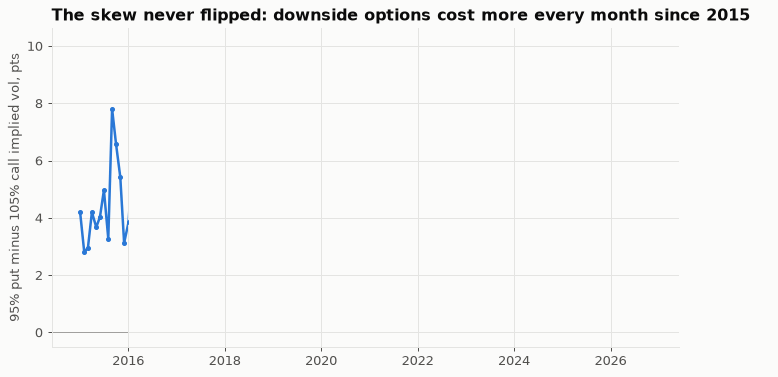</picture></a></td>
</tr></table>

- **Crash protection was the most overpriced part:** against the volatility NIFTY actually showed until
  expiry, the 95% put's implied vol was a median 5.4 points too high (higher in 90% of months), the
  at-the-money option's 2.0 points (70%) and the 105% call's 1.1 points (58%).
- **Until it wasn't:** on 2 Mar 2020 the 95% put was priced at 28% volatility; NIFTY then moved at 88%.
- India VIX averages across strikes, including the expensive puts, so the at-the-money implied vol ran
  a median 1.4 points below it. That is why finding 1, which priced at-the-money options at India VIX,
  slightly overstated their cost.

### 4. Delta hedging turned NIFTY option selling from a market bet into a volatility bet, with a sixth of the risk

<a href="docs/img/hedge_cumulative.png"><picture><source media="(prefers-reduced-motion: reduce)" srcset="docs/img/hedge_cumulative.png">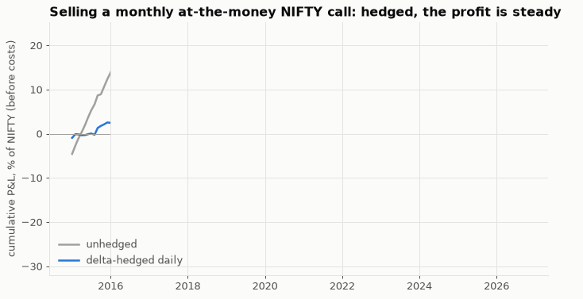</picture></a>

Each month (143 months, 2015–2026), sell the at-the-money NIFTY call and, separately, the 95% put at
their real implied volatilities from finding 3, then hold delta units of NIFTY, rebalanced at each
day's close, until expiry. The dividend yield comes from the options' own forward. Before trading costs
(section 6 adds them).

- **Risk fell to a sixth:** the at-the-money call's monthly P&L swung by 2.53% of NIFTY unhedged and
  0.44% hedged daily (0.75% hedged weekly).
- **The sign flipped:** unhedged, selling the call lost 0.17% a month on average (−24% in total, mostly
  in the 2020–21 rally); hedged, it made 0.16% a month (+22% in total) and won 69% of months.
- **The 95% put:** hedged, it made 0.09% a month and won 83% of months; its worst month, March 2020,
  lost 2.9% of NIFTY hedged against 16.2% unhedged.

<table><tr>
<td><a href="docs/img/hedge_gap.png"><picture><source media="(prefers-reduced-motion: reduce)" srcset="docs/img/hedge_gap.png">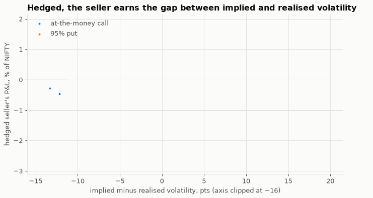</picture></a></td>
<td><a href="docs/img/hedge_frequency.png"><picture><source media="(prefers-reduced-motion: reduce)" srcset="docs/img/hedge_frequency.png">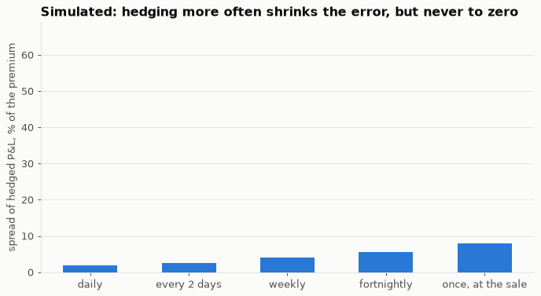</picture></a></td>
</tr></table>

- **What a hedged seller earns is the volatility gap:** the monthly P&L tracked implied minus realised
  volatility (correlation 0.74 for the call, 0.76 for the put). Hedged, March 2020 still cost the call
  seller 1.3% even though the call expired worthless, because NIFTY moved at 88% volatility against 25%
  priced in. The worst hedged month was September 2019 (the corporate-tax-cut jump), −1.7%.
- **Hedging is never perfect:** on simulated paths where realised volatility exactly equals implied,
  the hedged P&L still spreads by 16% of the premium with daily rebalancing, 33% weekly and 66% when the
  hedge is set only once (left). Black-Scholes's risk-free hedge assumes continuous trading.

### 5. Priced off NIFTY futures (Black-76), calls and puts agree; priced off spot without dividends, they disagree by 1.7 vol points

<table><tr>
<td><a href="docs/img/b76_gap.png"><picture><source media="(prefers-reduced-motion: reduce)" srcset="docs/img/b76_gap.png">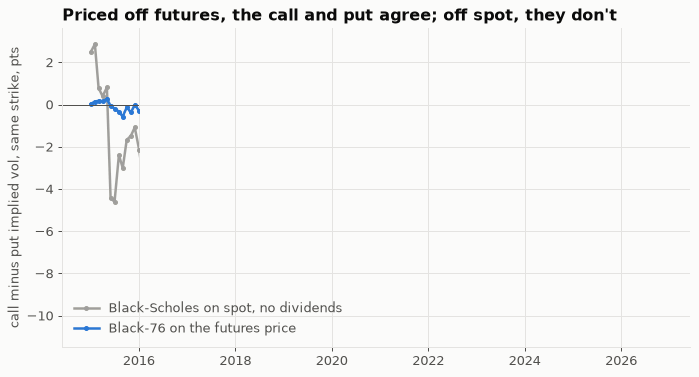</picture></a></td>
<td><a href="docs/img/b76_carry.png"><picture><source media="(prefers-reduced-motion: reduce)" srcset="docs/img/b76_carry.png">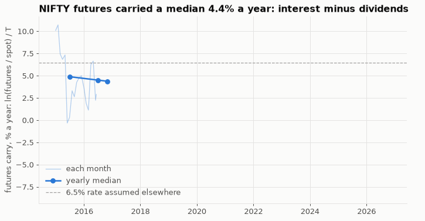</picture></a></td>
</tr></table>

Black-76 prices an option off the futures price instead of spot. The futures price already contains the
carry (interest minus dividends), so no dividend estimate is needed. Each month (143), the call and put
at the strike nearest NIFTY futures are run through both models.

- **Same strike, same expiry, so the two implied vols should match.** With Black-76 on the futures price
  they did, to a median 0.16 points. With Black-Scholes on spot and no dividends they were 1.66 points
  apart (calls a median 1.44 points too low, worst 10.8): assuming a 6.5% carry with no dividends puts
  the forward too high.
- **The carry in futures:** ln(futures ÷ spot) ÷ time ran at a median 4.4% a year, so dividends and
  financing differences took about 2.1% off the 6.5% rate assumed elsewhere. It dipped to 1.1% in 2020
  (rate cuts and futures trading at a discount in the crash) and to 3.1% in the June–August dividend
  season, against 4.7% in other months. Monthly values are noisy: the spot close and the futures
  settlement price are not taken at exactly the same moment.
- This is why section 3 took the forward from put-call parity rather than from spot.

## Quick start

```bash
uv sync
uv run python scripts/fetch_data.py                                   # Yahoo Finance -> data/prices.parquet
uv run bsp price --spot 25000 --strike 25500 --days 30 --vol 0.15    # call and put
uv run python scripts/fetch_options.py                                # NSE archive -> data/options/ (local only)
uv run bsp report pricing                                             # also: greeks, iv, hedging, black76
uv run python scripts/build_site.py                                   # dashboard -> site/index.html
uv run pytest
```

## Design

- `src/bsp/bs.py`: Black-Scholes prices (vectorised) and a Monte Carlo check.
- `src/bsp/options.py`, `iv.py`: NSE F&O bhavcopy download and parsing; implied volatility (Brent's
  method), forward from put-call parity, and each month's smile. Raw NSE data is never committed; only
  the derived implied vols and carry (`docs/data/`) are, so the dashboard can rebuild without it.
- `src/bsp/black76.py`: Black-76 price and implied vol for options on futures.
- `src/bsp/hedge.py`: delta-hedging simulator (any rebalancing interval, dividend yield, cash at r).
- `src/bsp/greeks.py`: analytic Greeks in reading units (per ₹1, per vol point, per day, per 1% rate).
- `src/bsp/pricer.js`: the same formula for the browser; a test compares it with Python through Node.
- `src/bsp/reports.py`: README findings, reproducible with `bsp report <topic>`.
- `src/bsp/site.py`, `calculator.html`, `page.html`: the dashboard, one static page; no server.

MIT licence.
