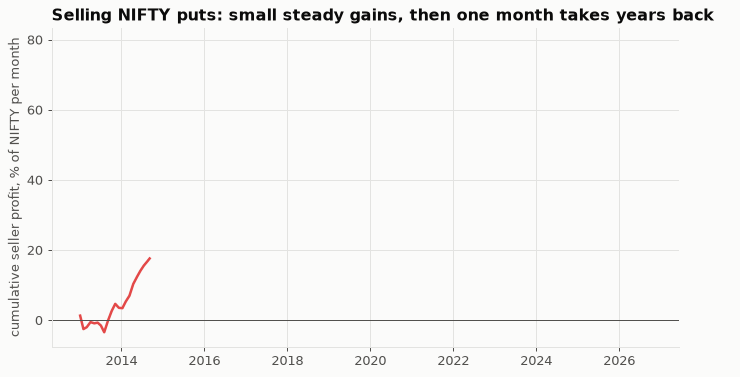
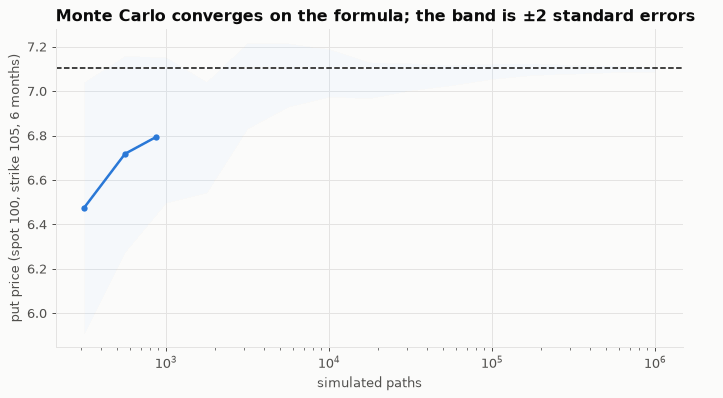

# Black-Scholes Pricer

[](https://github.com/Dhirajdas18/black-scholes-pricer/actions/workflows/ci.yml)
[](https://dhirajdas18.github.io/black-scholes-pricer/)

European option pricing with the Black-Scholes model, tested against what NSE options actually did: what
NIFTY options cost against what they paid, how the Greeks behave, implied volatility on real option
prices, and delta hedging on real NIFTY paths.

**Live calculator and dashboard: [dhirajdas18.github.io/black-scholes-pricer](https://dhirajdas18.github.io/black-scholes-pricer/)**.
The pricer runs in the browser as you type; the charts are rebuilt weekly by GitHub Actions.

## Features

- [x] Black-Scholes prices with a dividend yield, put-call parity, Monte Carlo check (antithetic paths)
- [x] In-browser pricer, tested against the Python implementation through Node
- [ ] Greeks: delta, gamma, vega, theta, rho
- [ ] Implied volatility on real NIFTY option prices; smile and skew
- [ ] Delta hedging on real NIFTY paths
- [ ] Black-76 for options on futures
- [ ] Indian option costs (STT on premium and exercise) and what option strategies net
- [ ] Model limits: jump-diffusion vs Black-Scholes

## Findings

### 1. Priced at India VIX, a NIFTY put cost a third more than it paid out on average, until one month

<table><tr>
<td><a href="docs/img/pricing_insurance.png"><picture><source media="(prefers-reduced-motion: reduce)" srcset="docs/img/pricing_insurance.png"></picture></a></td>
<td><a href="docs/img/pricing_seller.png"><picture><source media="(prefers-reduced-motion: reduce)" srcset="docs/img/pricing_seller.png"></picture></a></td>
</tr></table>

Each month, a one-month at-the-money NIFTY option is priced with Black-Scholes at that day's India VIX
(a 6.5% risk-free rate, no dividends) and held to expiry. Months don't overlap; every figure is the median
across the 21 possible monthly start days (162 months each), so no start date is cherry-picked.

- **Puts:** the premium averaged 1.66% of NIFTY and the payout 1.26%. A put seller kept about 0.40% of the
  index a month before costs, positive for every start day (0.30% to 0.48%). Puts finished in the money in
  40% of months.
- **One month erased years of that.** From 18 Feb 2020 the put paid out 27% of the index against a 1.4%
  premium, wiping out more than five years of the seller's gains in one month.
- **Calls were about fair:** 2.20% premium against 2.24% average payout. Black-Scholes uses one volatility
  for both, and India VIX ran above the volatility that followed
  ([returns-volatility study](https://github.com/Dhirajdas18/returns-volatility-dashboard)), but NIFTY's
  drift above the risk-free rate added to calls and took from puts.
- These are model prices at India VIX, not traded premiums; section 3 repeats the comparison with real NSE
  option prices, where out-of-the-money puts cost more than India VIX implies.

<a href="docs/img/pricing_mc.png"><picture><source media="(prefers-reduced-motion: reduce)" srcset="docs/img/pricing_mc.png"></picture></a>

- **The formula checks out:** a one-million-path Monte Carlo (antithetic pairs) priced a test put at
  7.0986 ± 0.0054 against the formula's 7.1061, within 1.4 standard errors. The tests also pin Hull's
  textbook example (call 4.76, put 0.81) and put-call parity.

## Quick start

```bash
uv sync
uv run python scripts/fetch_data.py                                   # Yahoo Finance -> data/prices.parquet
uv run bsp price --spot 25000 --strike 25500 --days 30 --vol 0.15    # call and put
uv run bsp report pricing                                             # charts -> out/
uv run python scripts/build_site.py                                   # dashboard -> site/index.html
uv run pytest
```

## Design

- `src/bsp/bs.py`: Black-Scholes prices (vectorised) and a Monte Carlo check.
- `src/bsp/pricer.js`: the same formula for the browser; a test compares it with Python through Node.
- `src/bsp/reports.py`: README findings, reproducible with `bsp report <topic>`.
- `src/bsp/site.py`, `calculator.html`, `page.html`: the dashboard, one static page; no server.

MIT licence.
