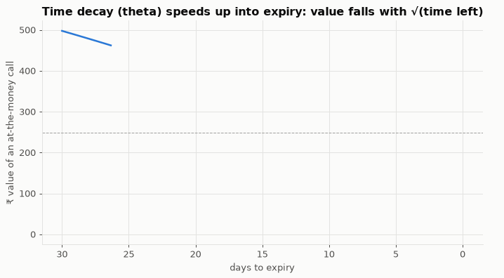

# Black-Scholes Pricer

[](https://github.com/Dhirajdas18/black-scholes-pricer/actions/workflows/ci.yml)
[](https://dhirajdas18.github.io/black-scholes-pricer/)

European option pricing with the Black-Scholes model, tested against what NSE options actually did: what
NIFTY options cost against what they paid, how the Greeks behave, implied volatility on real option
prices, and delta hedging on real NIFTY paths.

**Live calculator and dashboard: [dhirajdas18.github.io/black-scholes-pricer](https://dhirajdas18.github.io/black-scholes-pricer/)**.
The pricer runs in the browser as you type; the charts are rebuilt weekly by GitHub Actions.

## Features

- [x] Black-Scholes prices with a dividend yield, put-call parity, Monte Carlo check (antithetic paths)
- [x] In-browser pricer, tested against the Python implementation through Node
- [x] Greeks: delta, gamma, vega, theta, rho (analytic, tested against finite differences; live in the calculator)
- [ ] Implied volatility on real NIFTY option prices; smile and skew
- [ ] Delta hedging on real NIFTY paths
- [ ] Black-76 for options on futures
- [ ] Indian option costs (STT on premium and exercise) and what option strategies net
- [ ] Model limits: jump-diffusion vs Black-Scholes

## Findings

### 1. Priced at India VIX, a NIFTY put cost a third more than it paid out on average, until one month

<table><tr>
<td><a href="docs/img/pricing_insurance.png"><picture><source media="(prefers-reduced-motion: reduce)" srcset="docs/img/pricing_insurance.png"></picture></a></td>
<td><a href="docs/img/pricing_seller.png"><picture><source media="(prefers-reduced-motion: reduce)" srcset="docs/img/pricing_seller.png"></picture></a></td>
</tr></table>

Each month, a one-month at-the-money NIFTY option is priced with Black-Scholes at that day's India VIX
(a 6.5% risk-free rate, no dividends) and held to expiry. Months don't overlap; every figure is the median
across the 21 possible monthly start days (162 months each), so no start date is cherry-picked.

- **Puts:** the premium averaged 1.66% of NIFTY and the payout 1.26%. A put seller kept about 0.40% of the
  index a month before costs, positive for every start day (0.30% to 0.48%). Puts finished in the money in
  40% of months.
- **One month erased years of that.** From 18 Feb 2020 the put paid out 27% of the index against a 1.4%
  premium, wiping out more than five years of the seller's gains in one month.
- **Calls were about fair:** 2.20% premium against 2.24% average payout. Black-Scholes uses one volatility
  for both, and India VIX ran above the volatility that followed
  ([returns-volatility study](https://github.com/Dhirajdas18/returns-volatility-dashboard)), but NIFTY's
  drift above the risk-free rate added to calls and took from puts.
- These are model prices at India VIX, not traded premiums; section 3 repeats the comparison with real NSE
  option prices, where out-of-the-money puts cost more than India VIX implies.

<a href="docs/img/pricing_mc.png"><picture><source media="(prefers-reduced-motion: reduce)" srcset="docs/img/pricing_mc.png"></picture></a>

- **The formula checks out:** a one-million-path Monte Carlo (antithetic pairs) priced a test put at
  7.0986 ± 0.0054 against the formula's 7.1061, within 1.4 standard errors. The tests also pin Hull's
  textbook example (call 4.76, put 0.81) and put-call parity.

### 2. NIFTY beat its daily break-even move less often than Black-Scholes assumes, except in jumps

<table><tr>
<td><a href="docs/img/greeks_curves.png"><picture><source media="(prefers-reduced-motion: reduce)" srcset="docs/img/greeks_curves.png"></picture></a></td>
<td><a href="docs/img/greeks_theta.png"><picture><source media="(prefers-reduced-motion: reduce)" srcset="docs/img/greeks_theta.png"></picture></a></td>
</tr></table>

The Greeks measure how an option's price reacts to each input: **delta** to the price, **gamma** to how
fast delta changes, **vega** to volatility, **theta** to time, **rho** to interest rates. All five are
tested against finite differences and shown live in the [calculator](https://dhirajdas18.github.io/black-scholes-pricer/).

- **Near expiry, an at-the-money option turns into a switch.** With a day left, delta jumps from 0 to 1
  across a few hundred points of NIFTY and gamma is about five times its 30-day level (left).
- **Time decay speeds up:** an at-the-money call loses half its value in the first 21.5 of its 30 days and
  the other half in the last 8.5 (right).

<a href="docs/img/greeks_breakeven.png"><picture><source media="(prefers-reduced-motion: reduce)" srcset="docs/img/greeks_breakeven.png"></picture></a>

- **The daily race between gamma and theta:** an at-the-money option holder gains from big moves and pays
  time decay every day, and the two cancel when NIFTY moves India VIX ÷ √252 in a day. Over 3,413 days
  NIFTY beat that break-even move on 21.9% of days, where a bell curve at the same volatility gives 31.7%,
  so the holder lost the day 78% of the time.
- **But the biggest days were bigger than a bell curve allows:** moves beyond 3× the break-even came on
  0.35% of days against 0.27%. The top 1% of days earned back about half of the holder's daily losses;
  the holder still finished behind. This is the volatility risk premium seen one day at a time.
- **Delta and gamma predict a day's option price change well, until a jump:** for a 30-day at-the-money
  call, delta + gamma + theta missed the real change by a median 0.03% of the option's price, 0.37% on days
  NIFTY moved more than 3%, and 9.2% on 20 Sep 2019 (the corporate-tax-cut day, NIFTY +5.2%).

## Quick start

```bash
uv sync
uv run python scripts/fetch_data.py                                   # Yahoo Finance -> data/prices.parquet
uv run bsp price --spot 25000 --strike 25500 --days 30 --vol 0.15    # call and put
uv run bsp report pricing                                             # also: greeks
uv run python scripts/build_site.py                                   # dashboard -> site/index.html
uv run pytest
```

## Design

- `src/bsp/bs.py`: Black-Scholes prices (vectorised) and a Monte Carlo check.
- `src/bsp/greeks.py`: analytic Greeks in reading units (per ₹1, per vol point, per day, per 1% rate).
- `src/bsp/pricer.js`: the same formula for the browser; a test compares it with Python through Node.
- `src/bsp/reports.py`: README findings, reproducible with `bsp report <topic>`.
- `src/bsp/site.py`, `calculator.html`, `page.html`: the dashboard, one static page; no server.

MIT licence.
